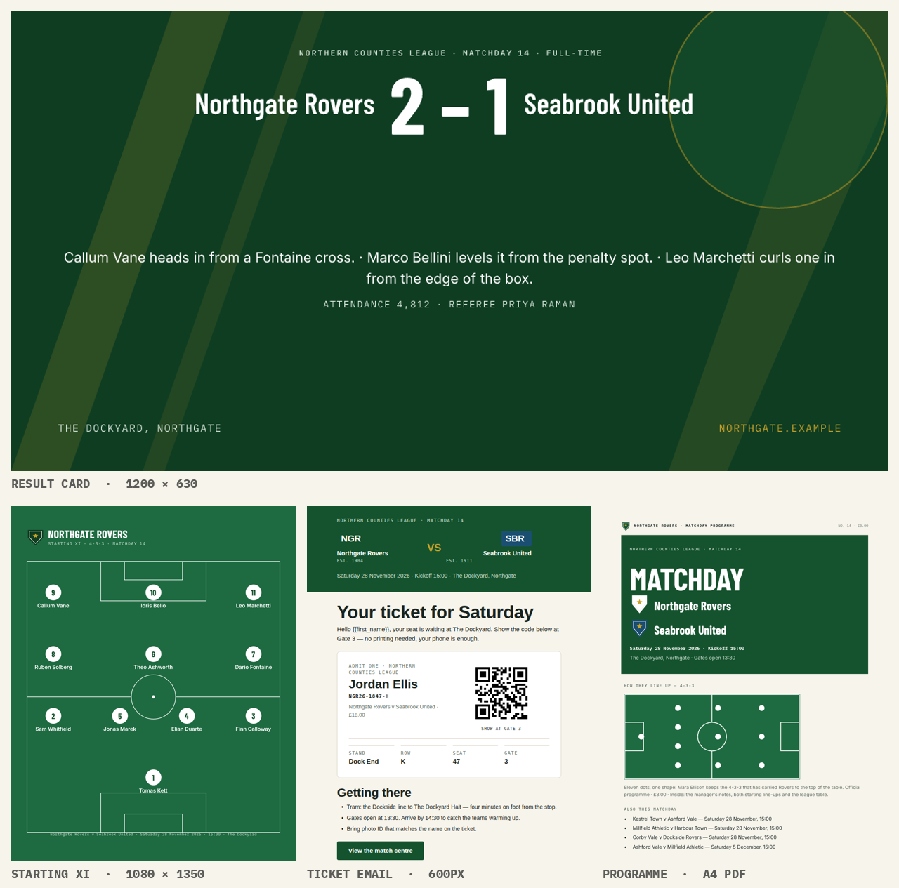
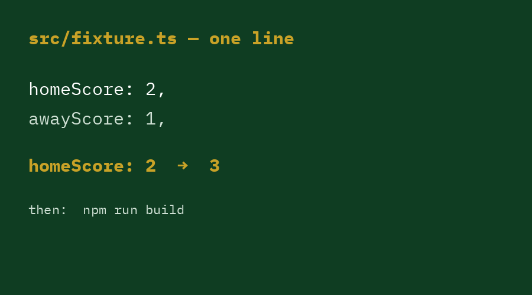
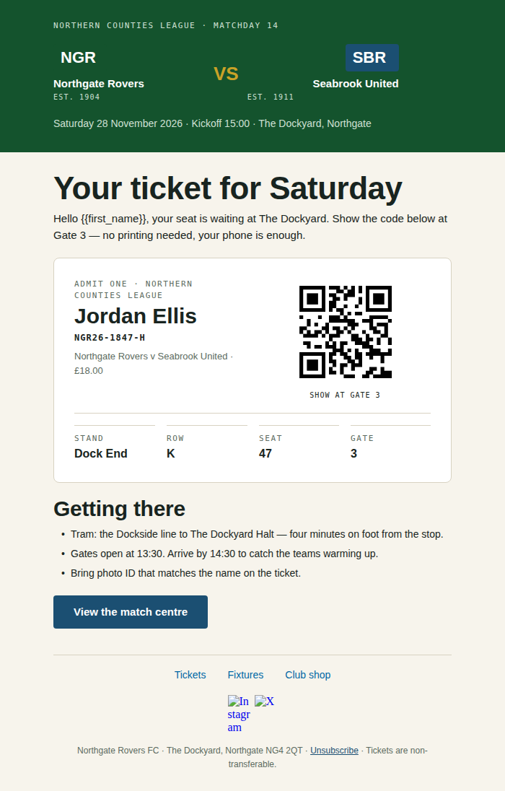
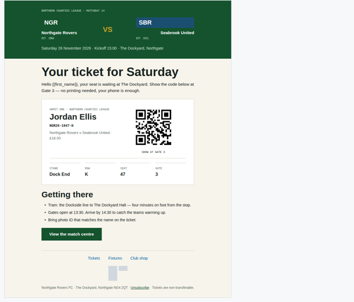
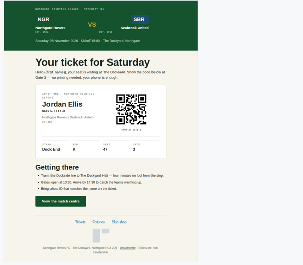

# Matchday — a football club's matchday kit, in Hyper Elements

**One typed fixture file drives a whole matchday: a ticket email, a 4-page programme PDF, a starting-XI social image, a full-time result card, and a match-centre page — all from `src/fixture.ts`.**



Everything here is invented: the clubs (Northgate Rovers, Seabrook United), the players, the venue (The Dockyard), the sponsor (Harbour & Pine). No real clubs, players, logos or sponsors. Built for the [Unlayer Hyper Elements Template Challenge](https://github.com/hyper-elements/hyper-elements/discussions/categories/challenge-submissions) — $500 pool, five $100 winners, deadline 29 November 2026.

## One line changes everything



The GIF is real: `homeScore: 2` became `homeScore: 3` in `src/fixture.ts`, then `npm run build` re-rendered the result card (2–1 → 3–1) and the match-centre page (2–1 → 3–1). The same mechanism regroups the whole starting XI when the formation changes — `4-3-3` → `3-5-2` re-slices the eleven into lines on the pitch image, in the programme, and on the page. Nothing is hard-coded twice: the score, the scorers, the timeline, the league table, the subs and the other fixtures all live in `fixture.ts` and every root reads that file.

## The five outputs

| Output | Root | File | Size |
|---|---|---|---|
| Ticket email | `Email` | `output/matchday-ticket.email.html` (+ `.txt`) | 27 KB — under Gmail's 102 KB clip |
| Match-centre page | `Page` | `output/match-centre.web.html` | responsive, one phone breakpoint |
| Programme | `Document` | `output/matchday-programme.pdf` | A4, 4 pages exactly |
| Starting XI | `Canvas` | `output/starting-xi.png` | 1080 × 1350 |
| Result card | `Canvas` | `output/result-card.png` | 1200 × 630 |

Each one is designed for its medium, not the same layout copied four times: the email is a ticket (seat, gate, scannable code); the programme is a printable artefact (manager's notes, line-ups + subs, league table, ticket stub); the XI image is the formation drawn as a pitch; the result card is the score at 110px; the page is the post-match read (timeline, line-ups, next-home-game ticket band).

## How to run it

```bash
npm install
npm run build    # validates, then writes everything to output/
npm run check    # hyper-elements check on src/templates --json
npm test         # Vitest: every root renders with zero diagnostics
npm run preview  # email-client previews (Outlook, Gmail, Apple Mail)
```

Node 20+ (developed on 24). `npm run build` is deterministic: rendering twice produces the same files. PDF and Canvas rendering needs nothing from the network — the fonts are local TTFs in `fonts/`, passed as bytes.

## Make your own club

Edit `src/fixture.ts` — one file, fully typed:

```ts
export const FIXTURE: Fixture = {
  competition: "Northern Counties League",
  matchday: 14,
  date: "Saturday 28 November 2026",
  kickoff: "15:00",
  venue: "The Dockyard",
  city: "Northgate",
  home: {
    name: "Northgate Rovers",
    short: "NGR",          // three-letter code, shown on badges
    founded: 1904,
    formation: "4-3-3",    // "4-3-3", "4-4-2" or "3-5-2" — anything else throws
    players: [             // goalkeeper first, then defenders, midfielders, forwards
      { number: 1, name: "Tomas Kett" },
      // ... eleven in total
    ],
    subs: [ /* five substitutes */ ],
    color: "#14532d",
  },
  away: { /* same shape */ },
  homeScore: 2,
  awayScore: 1,
  status: "FULL-TIME",
  timeline: [ { minute: "12'", text: "Goal — Callum Vane heads in from a Fontaine cross.", team: "home" } ],
  ticket: { holder: "Jordan Ellis", number: "NGR26-1847-H", stand: "Dock End", row: "K", seat: "47", gate: "3", price: "£18.00" },
  league: [ /* top-five table */ ],
  // ...
};
```

Then `npm run build`. The formation string is the data: `formationLines()` in `src/pitch.ts` slices the eleven into lines, so the pitch image, the programme's cover map and the line-up tables all regroup from that one string. A bad formation (`4-4-3`) fails loudly at build time instead of mis-laying out.

## How Hyper Elements is used

**Four roots, one design system.** `src/theme.ts` defines the brand once with `defineTheme()` — paper/ink, one pine club colour, one gold accent, Barlow Condensed for display, Inter for body, IBM Plex Mono for labels — and every template takes it as an optional `theme` prop that defaults to the home theme (Northgate Rovers, pine). The away theme (Seabrook United, deep sea blue) is derived with `extendTheme()` in the same file: pass `theme={awayTheme}` to any template to re-skin it.

```tsx
<TicketEmail fixture={FIXTURE} theme={awayTheme} />
```

What re-skins is what reads the theme tokens: the email's "View the match centre" button goes pine `#14532d` → sea blue `#1b4f72`, and the match-centre page's theme tokens and button hover follow. The two Canvas images and the programme PDF keep their hardcoded club colours, so they render identically under either theme — the re-skin is a token re-skin, not a find-and-replace. Proof, the away ticket email:



Regenerate it with `npx tsx scripts/render-away.ts`.

```tsx
const homeTheme = defineTheme({
  colors: { background: "#f7f4ec", foreground: "#182420", primary: "#14532d", muted: "#5c6b60", border: "#d8d2c2" },
  fonts: { body: "Inter, Arial, sans-serif", heading: "'Barlow Condensed', 'Arial Narrow', sans-serif" },
  components: {
    Heading: { by: { level: { 1: { fontSize: 44, mobile: { fontSize: 34 } } } } },
    Button: { borderRadius: 4, padding: [14, 28], hover: { backgroundColor: "#0f3d22" } },
  },
  styles: { card: { backgroundColor: "#ffffff", padding: 28, gap: 16, borderRadius: 8 } },
});
```

**Shared blocks with `component()`.** `TeamBadge`, `ScoreLine`, `Lineup` and `InfoPill` in `src/components.tsx` are written once with typed `prop.*` props and reused across all four roots — the same `ScoreLine` is the email's header, the page hero and the result card (with a `size="large"` variant). The crest and the pitch are `Svg` helpers drawn from the fixture data: the pitch's player dots *are* the formation.

```tsx
export const ScoreLine = component({
  type: "matchday.ScoreLine",
  props: {
    home: prop.text({ label: "Home team", required: true }),
    homeScore: prop.number({ label: "Home score", integer: true, min: 0, max: 99, default: 0 }),
    size: prop.choice(["standard", "large"] as const, { label: "Size", default: "standard" }),
  },
  render: ({ home, homeScore, /* ... */ }) => ( /* ... */ ),
});
```

**Rendering.** `src/render-all.ts` validates first, then renders: `render()` for the Email and Page, `renderPdf()` from `@hyper-elements/react/pdf` for the programme, `renderImage()` from `@hyper-elements/react/image` for the two Canvas images.

```ts
const email = await render(createElement(TicketEmail, { fixture: FIXTURE }));
const pdf = await renderPdf(createElement(ProgrammeDoc, { fixture: FIXTURE }), { fonts });
const xi = await renderImage(createElement(StartingXi, { fixture: FIXTURE }), { fonts });
```

Fonts travel two ways on purpose: Email and Page load the faces as webfonts (Fontsource WOFF2), while PDF and Canvas get the same families as local TTF bytes — Satori and react-pdf cannot draw WOFF2, and nothing is fetched at render time. The ticket's scannable code is a PNG `Image` (generated at build time from the ticket number, embedded as a `data:` URI) because `Svg` is an error inside `<Email>`; the programme's copy of the same code *is* drawn as `Svg` vectors.

**Validation and lint.** The build fails on any error or warning — `validate()` per root, plus the email-client plugin on the email — and `npx hyper-elements check src/templates --json` is the same gate in CI. Current state: **5 templates, 0 errors, 0 warnings** (the remaining notes are info-level: small-caps labels under 14px, which the lint flags and the design keeps deliberately, and the usual email-client degradations). `outline()` output for every root is written to `output/outline-*.txt` by the build, and the layout was checked against it — including the rule that layout never measures text, so the long-name, 3-5-2, 0-0 and 6-5 edge cases in `scripts/edge-cases.ts` are rendered and inspected, not assumed.

**Email-client emulator.** `@hyper-elements/email-clients` runs the ticket email through Classic Outlook, Outlook.com, Gmail and Apple Mail locally — `npm run preview` writes a preview per client to `out/clients/`. What it found, and what was done about it:

- Classic Outlook (Word) drops `border-radius` and web fonts — the ticket card and badges fall back to square corners and the system stacks, and still read correctly.
- Outlook.com drops the hover state and `@media` rules — the layout is fluid (inline-block columns wrap) so phones still get a readable email.
- Gmail strips `@font-face` — every stack ends in a font the client has.
- The social icons are the library's own CDN images; they load in real clients (verified live) and show as placeholders only in the offline emulator screenshots below.

| Classic Outlook | Gmail | Apple Mail |
|---|---|---|
|  |  |  |

Known Outlook quirk, left as-is: Word ignores the fixed width on the away badge, so the blue `SBR` chip renders wider than the home one. It still reads as a badge; every other client renders both chips compact.

## Tests

`tests/matchday.test.ts` (Vitest, `npm test`) renders every root and asserts zero errors and zero warnings, the email under 102 KB, the PDF starting `%PDF-`, the images at 1080×1350 and 1200×630, formation parsing (`4-3-3` → `[4, 3, 3]`), and the ticket code being deterministic. It also renders all five templates with `awayTheme` (zero diagnostics) and asserts the away email's button is sea blue while the home email's is pine. GitHub Actions (`.github/workflows/ci.yml`) runs `npm run check`, `npm test` and `npm run build` on every push and pull request.

## Layout

```
matchday/
├── src/
│   ├── fixture.ts            # the match: one typed object, everything reads it
│   ├── theme.ts              # defineTheme home theme + extendTheme away theme
│   ├── components.tsx        # component() shared blocks + Svg crest/pitch
│   ├── pitch.ts              # formation parsing + line slicing
│   ├── code.ts               # seeded ticket-code grid (PNG + Svg path)
│   ├── fonts.ts              # webfont faces + local TTFs as bytes
│   ├── render-all.ts         # validate -> render -> output/
│   └── templates/
│       ├── ticket-email.tsx      # Email 600px
│       ├── match-centre-page.tsx # Page 960px
│       ├── programme-doc.tsx     # Document A4, 4 pages
│       ├── xi-canvas.tsx         # Canvas 1080x1350
│       └── result-canvas.tsx     # Canvas 1200x630
├── scripts/
│   ├── edge-cases.ts         # long name / 3-5-2 / 0-0 / 6-5 renders
│   ├── render-away.ts        # renders the away-theme email proof
│   ├── shot.mjs              # Playwright screenshots of email + page
│   └── make-readme-assets.py # hero + GIF + client crops (from real renders)
├── tests/matchday.test.ts
├── fonts/                    # local TTFs for renderPdf/renderImage
├── docs/                     # hero.png, fixture-edit.gif, away-theme-email.png, clients/
└── output/                   # generated by npm run build (git-ignored)
```

## Licence

MIT. The Hyper Elements library itself is MIT.
